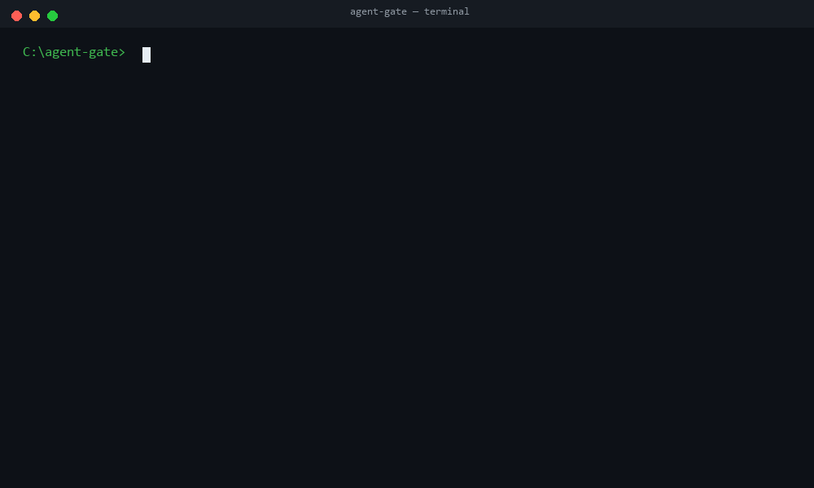

<p align="center">
  
</p>

<h1 align="center">agent-gate</h1>

<p align="center"><strong>Stop shipping dumb agents.</strong><br>阻止上线变蠢的 Agent。</p>

---

## 痛点

Agent 的退化不报错。

它只是悄悄地：

- 乱调工具——该调一次的调三次，或调了个不相干的；
- 瞎编数据——工具返回 22℃，它输出 25℃；
- 烧钱——token 从 200 涨到 800，没人知道为什么。

CI 全绿，日志全平，直到用户投诉你才发现。

**agent-gate 把"变蠢"变成 CI 红灯。** 每次提 PR，它跑一遍你的 Agent 轨迹，对照你写死的判定条件：退化就 block，可疑就 warn，报告直接评论在 PR 上。

## Quickstart

三步，5 分钟。

### 1. 复制 workflow

把 [.github/workflows/agent-gate.yml](.github/workflows/agent-gate.yml) 拷进你的仓库。它只做三件事：跑 `gate.py` → 把 `report.md` 评论到 PR → 按退出码让 CI 变红/变绿。

### 2. 配置 gate.yaml

写死你的 Agent 边界。以天气查询 Agent 为例：

```yaml
version: 1
agent: weather-query-agent

signals:
  - id: S1
    name: '温度与工具返回不一致'
    observe: [final_output, tool_calls]
    level: block          # 触发 → 退出码 1 → CI 红
  - id: S3
    name: '工具序列偏离约定'
    observe: [tool_calls]
    level: block
    call_count_threshold: 3
  - id: S5
    name: 'token 涨幅超 50%'
    observe: [cost]
    level: warn           # 只记录，不拦
    threshold_ratio: 1.5
    no_baseline_policy: warn

baselines:
  北京: 200               # 键 = user_input，值 = token baseline
```

每个信号 = 观察位置（最终输出 / 工具序列 / 成本）+ 可判定的触发条件 + 级别。**写行为，不写形容词**——`输出温度 ≠ temp_c` 可以跑，`输出不智能` 不行。

### 3. 提 PR

```bash
git checkout -b test/trigger-gate
git commit --allow-empty -m "test: trigger gate"
git push -u origin test/trigger-gate
gh pr create --fill
```

20 秒后看结果：绿 = 边界守住了；红 + 机器人评论 = 抓到退化了。

## 报告长什么样

不给你看 `exit code 1`，给你看人话：

```markdown
| 信号 | 名称                 | 级别  | 状态    | 细节                                                  |
|------|----------------------|-------|---------|-------------------------------------------------------|
| S1   | 温度与工具返回不一致   | block | ❌ BLOCK | 输出温度 25 ≠ temp_c 22（R1 提取自 '25℃'）            |
| S3   | 工具序列偏离约定       | block | ❌ BLOCK | 第 1 次调用已成功，其后仍出现 get_weather（非约定重试） |
| S5   | token 涨幅超 50%      | warn  | ⚠️ WARN  | total_tokens 800 > baseline 200 × 1.5 = 300          |
```

每条细节都定位到那次运行里的具体证据，不用猜。

## 亮点

**本地优先** — 核心判定就是一个 Python 脚本，本地直接跑：

```bash
python gate.py cases/my-trace.json --config gate.yaml --out report.md
```

CI 只是锦上添花。没有 GitHub 也能用，接任何 CI、任何 pre-merge hook 都行。

**零依赖** — 纯标准库。有 PyYAML 用 PyYAML，没有就用内置解析器，拷走即用，连 `pip install` 都省了。

**人话报告** — Markdown 表格，每条信号带触发细节（提取值、比对算式、子形态），评论在 PR 上人能读，不用翻日志。

## 轨迹格式

输入是一份轨迹 JSON，一次运行 = 一条：

```json
{
  "user_input": "北京",
  "input_type": "normal",
  "tool_calls": [
    { "tool": "get_weather", "args": {"city": "北京"}, "result": {"temp_c": 22, "condition": "晴"}, "success": true }
  ],
  "final_output": "北京 22℃，适合穿薄外套。",
  "total_tokens": 200
}
```

`cases/` 里有三个现成例子：全绿 baseline、四信号全触发的 degrade、空输入违规——拿来当模板改。

## 设计原则

1. **写行为，不写形容词** — 判定条件全是运行时断言，没有"变笨""不稳定"。
2. **写边界，不写愿景** — 能做什么、不能做什么、失败怎么办、最多几步，全写进 gate.yaml。
3. **写可观察信号** — 只看三处：最终输出、工具调用日志、token 计数。一次运行内可复现。

## License

MIT
